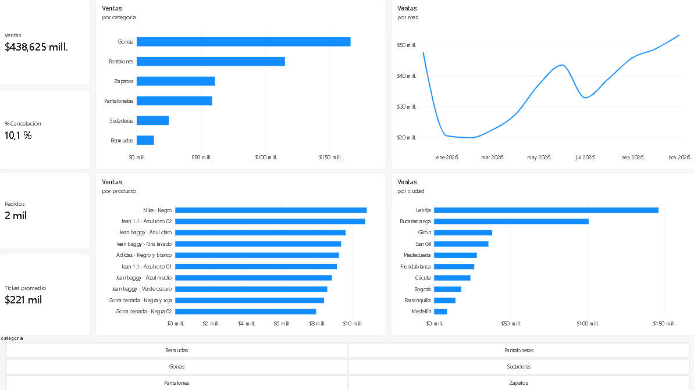
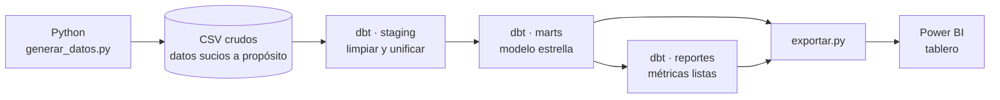

# 📊 VisagData — Análisis de ventas de VisagShop

[](https://github.com/stiven-triana-dev/VisagData/actions)


Proyecto de **análisis de datos** sobre las ventas de [VisagShop](https://github.com/stiven-triana-dev/VisagShop),
una tienda virtual de ropa urbana: de datos crudos y "sucios" a un tablero en Power BI, con cada paso
automatizado y probado.

> **Datos de ejemplo.** Se usa el **catálogo real** de la tienda (108 productos, categorías, precios y
> tallas), pero los clientes y los pedidos son **ficticios**, generados con una semilla fija: los clientes
> solo tienen un código y una ciudad, sin nombres, teléfonos ni direcciones.

## 📊 El tablero (Power BI)



Archivo: [`powerbi/VisagData_tablero.pbix`](powerbi/VisagData_tablero.pbix) (se abre con Power BI Desktop, gratis).

- **Modelo estrella:** `fct_ventas` en el centro, relacionada con `dim_productos` y `dim_clientes` (varios a uno).
- **Medidas en DAX:** `Ventas`, `Pedidos`, `Unidades` (sin pedidos cancelados), `Ticket promedio` y `% Cancelación`.
- **Gráficos:** tarjetas de indicadores, ventas por mes, por categoría, top 10 de productos (filtro *N superior*) y por ciudad.
- **Interactivo:** el filtro de categoría de abajo actualiza todo el tablero.
- Las cifras del tablero cuadran con las calculadas por dbt ($438,6 millones en 1.982 pedidos, 10,1 % de cancelación).

```
Ventas          = CALCULATE(SUM(fct_ventas[ingreso]), fct_ventas[estado] <> "cancelado")
Ticket promedio = DIVIDE([Ventas], [Pedidos])
```

## 🔄 Cómo fluyen los datos



| Capa | Modelos | Qué hace |
| --- | --- | --- |
| **staging** | `stg_productos`, `stg_clientes`, `stg_pedidos`, `stg_items_pedido` | Limpia los datos: unifica ciudades escritas de muchas formas ("bogota", " BOGOTÁ", "B/manga") con un diccionario (`seeds/ciudades.csv`) y métodos de pago ("NEQUI", "Contra entrega") |
| **marts** | `fct_ventas`, `dim_productos`, `dim_clientes` | Modelo estrella: una fila por producto vendido, más dimensiones de producto y cliente (con segmento: Nuevo, Recurrente, Frecuente) |
| **reportes** | `ventas_mensuales`, `ventas_categoria_mes`, `productos_top`, `ventas_por_ciudad`, `ventas_por_talla`, `pedidos_por_estado` | Métricas listas: ingresos, ticket promedio, crecimiento mensual, participación por ciudad, cancelación por método de pago |

## ✅ Calidad de los datos

`dbt build` corre **40 pruebas de datos** y **1 prueba unitaria** cada vez:

- **Claves:** sin duplicados ni vacíos; cada pedido apunta a un cliente que existe y cada producto vendido existe en el catálogo.
- **Valores permitidos:** estados, métodos de pago, tipos de venta y segmentos.
- **Limpieza:** si aparece una forma nueva de escribir una ciudad, la prueba falla y avisa qué agregar al diccionario.
- **Cuadre:** el total de ventas del modelo es igual al calculado directamente desde los pedidos (los cruces no pierden ni duplican filas).
- **Prueba unitaria:** el crecimiento mensual y el ticket promedio se calculan bien y los pedidos cancelados no cuentan.

Además, **9 pruebas con pytest** revisan el generador (mismos datos siempre, precios del catálogo real,
nadie compra antes de registrarse, sin datos personales) y el exportador.

La integración continua (GitHub Actions) corre todo y comprueba que los CSV publicados para Power BI
coinciden exactamente con los que produce el pipeline.

## 📈 Lo que muestran los datos (de ejemplo)

- **Temporadas:** diciembre es fuerte, enero cae a menos de la mitad, junio sube por la prima y noviembre es el mejor mes.
- **Ciudades:** Lebrija (donde está la tienda) y Bucaramanga concentran más de la mitad de las ventas.
- **Productos:** las gorras lideran en unidades y en ingresos; los pantalones son segundos en ingresos con muchas menos unidades, porque cada uno vale más.
- **Pagos:** la tasa de cancelación es parecida en contraentrega, Nequi y tarjeta (alrededor del 10 %).

## 🚀 Cómo ejecutarlo

```bash
python -m venv .venv
.venv\Scripts\activate                      # Linux/Mac: source .venv/bin/activate
pip install -r requirements-dev.txt

python datos/generar_datos.py               # 1. datos de ejemplo  -> datos/crudos/
dbt build --project-dir transformacion --profiles-dir transformacion   # 2. transformar y probar
python exportar.py                          # 3. CSV para Power BI -> powerbi/datos/
pytest                                      # pruebas en Python
```

> En Windows con *Control de aplicaciones inteligente*, si el comando `dbt` queda bloqueado, se puede
> usar `python -c "from dbt.cli.main import cli; cli(['build', '--project-dir', 'transformacion', '--profiles-dir', 'transformacion'])"`.

La base es un archivo **DuckDB** (`visag_ventas.duckdb`): SQL analítico sin instalar un servidor.

## Lo que aprendí con este proyecto

Hice VisagData para aprender el trabajo de un analista de datos con algo que ya conocía: las ventas de mi tienda. No quise usar datos reales de clientes, así que el catálogo es el real, pero los clientes y los pedidos los genero con Python a partir de una semilla fija. Eso me sirvió de dos formas: no expongo datos personales y los resultados salen iguales cada vez que corro el proyecto.

Los datos los ensucio a propósito, porque en la vida real nunca llegan limpios: la misma ciudad aparece como «bogota», « BOGOTÁ» o «B/manga», y los métodos de pago vienen escritos de varias maneras. Con dbt aprendí a limpiarlos por capas. En staging unifico y corrijo, en marts armo el modelo estrella con una tabla de ventas en el centro, y en reportes dejo las métricas listas. Lo que más me sirvió fueron las pruebas de datos: si mañana aparece una forma nueva de escribir una ciudad, dbt falla y me dice qué agregar al diccionario, en vez de dejar pasar el error en silencio.

La prueba que más me enseñó fue la del cuadre. Al unir tablas es fácil duplicar o perder filas sin darse cuenta, así que comparo el total de ventas del modelo con el total calculado directamente desde los pedidos. Si no coinciden, algo está mal en los cruces.

Usé DuckDB porque me deja hacer SQL analítico sobre un archivo, sin instalar ni pagar un servidor. En Power BI aprendí a montar el modelo estrella con relaciones de varios a uno, a escribir medidas en DAX (ventas, pedidos, ticket promedio y porcentaje de cancelación) y a revisar que las cifras del tablero cuadren con las de dbt.

El problema práctico más grande fue otra vez Windows: el Control de aplicaciones inteligente bloquea el ejecutable `dbt`, y tuve que correrlo desde Python. Para que el resultado sea confiable, los CSV que lee Power BI se exportan siempre en el mismo orden y en UTF-8, para que las tildes se vean bien, y GitHub Actions comprueba en cada cambio que los archivos publicados son exactamente los que produce el proceso.

## 🛠️ Tecnologías

Python 3.12 · dbt Core 1.12 · DuckDB · SQL · Power BI · pytest · ruff · GitHub Actions

## 👤 Autor

**Stiven** — Estudiante de Ingeniería de Sistemas · San Gil, Colombia
[GitHub](https://github.com/stiven-triana-dev) · [VisagShop](https://github.com/stiven-triana-dev/VisagShop) · [VisagAssist](https://github.com/stiven-triana-dev/VisagAssist) · [UniGest](https://github.com/stiven-triana-dev/UniGest)
